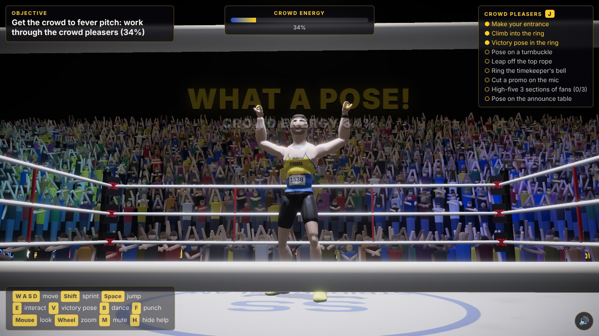
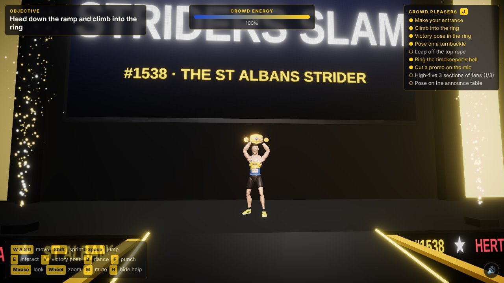
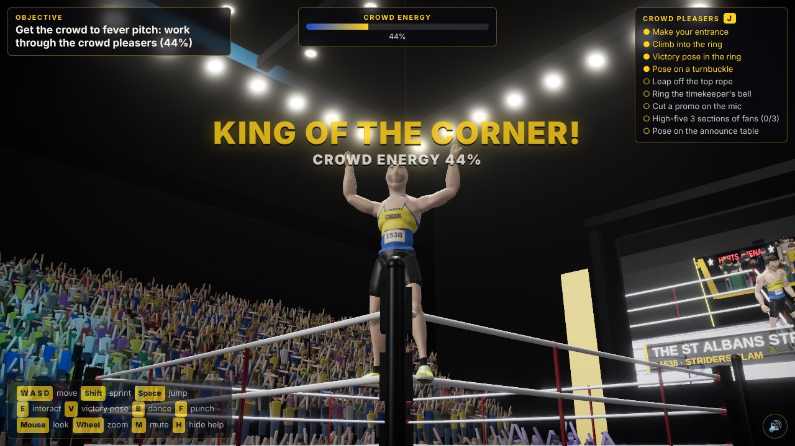
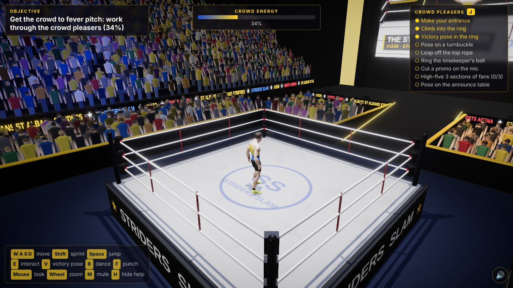
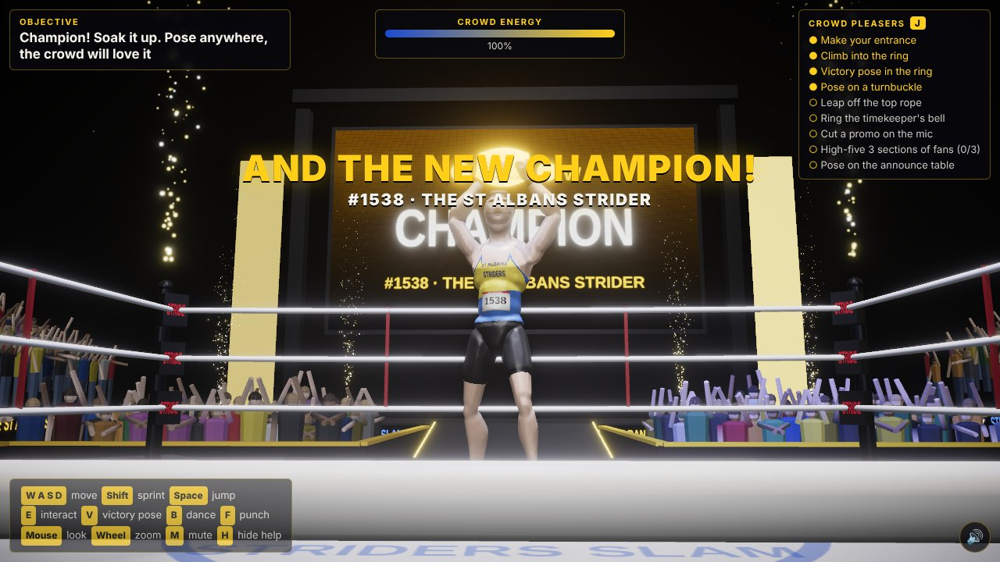

# Striders Slam: a playable wrestling arena

A small third-person game in the browser, built from a photo of a St Albans Striders runner (vest, race number 1538, yellow trainers) striking a victory pose in a wrestling ring. You walk the runner out of the entrance set, down the ramp, into the ring and around a packed arena.



## Play

Open `arena/index.html` in Chrome, Edge or Firefox; it works from `file://` with no server. Or serve it:

```sh
python3 -m http.server 8080 --directory arena   # then open http://localhost:8080
```

Phones get touch controls and a lighter quality setting automatically. Add `?q=1`, `?q=2` or `?q=3` to the address to force low, medium or high quality.

| Action | Keyboard & mouse | Touch | Gamepad |
|---|---|---|---|
| Move | W A S D / arrows | Left thumb | Left stick |
| Sprint | Shift | 🏃 Run (toggle) | RB / RT |
| Jump | Space | ⤒ Jump | A |
| Interact | E | ✋ Use | X |
| Victory pose | V | 🙌 Pose | Y |
| Dance / punch | B / F | 💃 / 👊 | LB / B |
| Look / zoom | Mouse (click to lock) / wheel | Right thumb | Right stick |
| Mute, help, list, unstick | M, H, J, Q | 🔊 | (none) |

## What there is to do

1. **Make your entrance.** Press E at the front of the stage: pyro, the entrance theme and the big screen.
2. **Climb into the ring.** Press E beside the apron, or walk up the steel steps and step through the ropes.
3. **Strike the pose.** V in the ring cuts to a low hero shot like the photo, and the crowd goes up.
4. **Win the crowd.** Nine crowd pleasers fill the crowd-energy meter: posing on a turnbuckle, leaping off the top rope, ringing the timekeeper's bell, cutting a promo at the announce table, high-fiving three sections of the front row, posing on the announce table, and more.
5. **The title.** At 100% the championship belt is lowered into the ring. Grab it and hold it high.

## How it was made

- **The runner** started as Quaternius's CC0 *Universal Animation Library* mannequin, which has 18 animations including idle, walk, jog, sprint, jump, dance, punches, roll, sitting and talking. [`tools/arena/build_runner.py`](../tools/arena/build_runner.py) runs in Blender 4.2. It voxel-remeshes the jointed mannequin into one smooth skin, then sculpts a face (brow, eye sockets, nose, lips, jaw and ears), short hair, a vest, shorts and trainers by displacement. It transfers the skin weights back on, keeps only the clips the game uses and exports a GLB. [`tools/arena/pack_runner.js`](../tools/arena/pack_runner.js) wraps that GLB in a script so the page loads from `file://`.
- **The kit** (the yellow-and-blue *ST ALBANS STRIDERS* vest, the 1538 bib, the face, stubble, hair, watch and striped trainers) is painted in the fragment shader from each vertex's rest-pose position ([`js/runner.js`](js/runner.js)).
- **The victory pose** is posed procedurally on top of the idle animation: the arms are aimed into a V, the fists clenched and the chest lifted.
- **The arena** ([`js/arena.js`](js/arena.js)) is generated at load. It has a ring with sagging ropes, padded turnbuckles and steel steps, plus barricades, an announce table, the timekeeper's bell, a ramp, a stage with a live big screen, a lighting rig with haze beams, scrolling LED boards, and about 4,300 instanced fans. The fans stand, cheer, clap, fist-pump, turn their heads to follow you and flash their phone cameras.
- **Sound** ([`js/audio.js`](js/audio.js)) is synthesised: the crowd bed, cheers and *woo*s, the "STRI-DERS!" chant with claps, the bell, pyro, footsteps and a short rock entrance theme.

To rebuild the vendored three.js bundle and the runner from scratch, run `BLENDER=/path/to/blender tools/arena/build.sh`. You need Node 18+, Blender 4.2 LTS and network access. `node tools/arena/shots.js <url of arena/index.html> <outdir>` plays a scripted run in headless Chromium and saves screenshots.

| | |
|---|---|
|  |  |
|  |  |

## Credits

- Character base mesh and animations: **Quaternius**, *Universal Animation Library* (Standard), CC0 1.0 ([opengameart.org](https://opengameart.org/content/universal-animation-library)). Reshaped in Blender by `tools/arena/build_runner.py`.
- **three.js** r186 (MIT) and **postprocessing** 6.39.5 (Zlib), bundled in `arena/vendor/`.
- Everything else (arena, crowd, textures, effects and sound) is generated in code. *Striders Slam*, the *Herts Arena* and the *Herts Arena 10K* are fictional.
